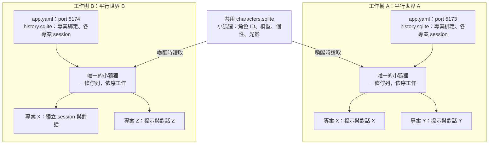

# 系統盤點:流程與 API

> 用途:重新設計介面前的地圖。先看清楚「有哪些能力、資料怎麼流」,再決定畫面怎麼擺。
> 產生時間 2026-08-10,對應 commit `7436023`。改了 IPC 或事件請順手更新這份。
> 搭配 [DESIGN-TODO.md](../DESIGN-TODO.md) 一起看。

## 0. 三十秒版

四個行程角色、三個視窗、一條 agent 管線:

```
┌─ main(Electron 主行程,依功能拆分)───────────────────────────────┐
│  設定落盤 · Tray 選單 · 游標輪詢 · 功率檔位 · 拖曳偵測          │
│  chatQueue(逐寵 FIFO)→ dispatcher → bridge → Provider        │
│                                    ↘ petToolsHub(MCP 回連)   │
└───────┬─────────────┬──────────────┬──────────────────────────┘
    IPC │             │              │
   ┌────▼────┐  ┌─────▼─────┐  ┌─────▼──────┐
   │ overlay │  │ settings  │  │  control   │
   │(疊層)  │  │(逐寵設定)│  │(中控面板) │
   │ 寵物+泡泡│  │ 四分頁    │  │ 三分頁     │
   └─────────┘  └───────────┘  └────────────┘
```

- **overlay** = `index.html` → `main.ts`(多寵 runtime)+ `viewer.ts`(渲染)+ `speechBubble.ts`(對話)
- **settings** = `settings.html` → `settings.ts`,一次只操作「選中的那隻」
- **control** = `control.html` → `control.ts`,一次看全部寵物

---

## 主程序模組與生命週期

入口 `src/main/index.ts` 從 1,938 行收斂為 282 行，保留依賴組裝、啟動順序與自驗分支。服務使用明確型別的依賴介面；需要最新視窗或 Store 時，以 getter 取得，避免關閉重開後仍使用舊參照。服務間不反向匯入入口。

| 模組 | 責任 |
| --- | --- |
| `runtimeTypes.ts`、`paths.ts` | 主程序內部型別、資料與資產路徑、快取位置、預設模型初始化、PID 與逐字稿路徑。 |
| `characters.ts` | 角色清單、專案選擇、喚醒／休息、模型綁定、序列化操作及設定儲存。沿用 SettingsStore 與 CharacterStore。 |
| `windows.ts`、`tray.ts` | 疊層／設定／中控視窗、互斥切換、聚焦與崩潰恢復；系統匣與原生選單。 |
| `chat.ts`、`control.ts`、`references.ts` | Agent bridge、寵物工具、逐寵派發、串流合併、逐字稿、任務帳本、中控快照及專案參考檔。 |
| `motions.ts`、`power.ts`、`drop.ts` | 動作清單與監看、預設姿勢與待機排程；功率檔位、游標輪詢；檔案拖曳接收窗。 |
| `ipc/` | 按 settings、chat、control、menu、overlay、references、pets 分組註冊。pets 組裝既有 petIpc 與 appearanceIpc。拖放的 pet-rects 通道由 drop 服務管理。 |
| `resourceScope.ts`、`lifecycle.ts` | 追蹤各模組 IPC、事件監聽、計時器及清理工作；統一結束與重啟。 |

建立服務時不開啟視窗或啟動背景工作；所有依賴連接完成後才啟動。資料路徑先於單實例鎖設定，ready 後讀設定、初始化角色，再啟動對話與動作、建立疊層、註冊 IPC、啟動桌面互動及系統匣。headless 自驗分支不建立視窗。

`start()` 對同一實例只執行一次；`dispose()` 可重複呼叫。需要重新啟動時建立新服務實例。結束先停止 IPC、計時器與監看，再關代理、儲存設定及銷毀視窗；單個清理失敗不阻止後續步驟。外觀 IPC 只移除自身註冊的 listener，不使用 removeAllListeners 清掉同通道的其他監聽器。

公開的 preload API、IPC 名稱／參數／回傳值與 YAML 格式未變更。`scripts/fixtures/main-ipc-channels.json` 保存重構前的 60 個通道（含原有角色與外觀模組），`test-main-modules.mjs` 比對註冊類型並驗證視窗授權及資源清理。此測試使用 Electron 替身；原生視窗互動仍需實際桌面驗收。

---

## 1. 使用者流程(User Flows)

### F1. 開機到看見寵物
`npm run start` → Vite 讀工作樹 `runtime_data/app.yaml` 的固定 port；main 讀精簡角色清單、語言與預設工作根目錄
→ 僅對原先啟用的角色執行喚醒，讀取 `characters.yaml` → 建疊層視窗 → renderer 對每隻成功喚醒的寵物建 runtime
→ `getBootVrm` 取模型 buffer → 載入 → 套 state/lighting/sway/wardrobe → `getDefaultPose` 播開機姿勢
→ pull `getChatQueue` 與 `getChatTranscript` 回填泡泡。

**畫面涉及**:疊層(角色)。**設計缺口**:沒有載入中的視覺回饋。

### F2. 跟寵物說一句話(核心流程)
```
hover 寵物 → 泡泡展開 → 打字 → Enter
  → chatSend(invoke,回 {queued, position, reason})
  → chatQueue 入列 → dispatcher 判斷可跑就發 turnStart
  → bridge.chatSend → Provider(codex/claude)
  → 串流事件:thinking / tool / text / approval / done|error
  → main 合併 text(33ms)→ chat-event-apply → 泡泡渲染
  → done 時 persistTranscript 落盤(供下次重啟回填)
```
**關鍵約定**:每個 turn 恰有一個終結事件(`done` 或 `error`);`approvalResolved` 不是終結事件。
**畫面涉及**:泡泡(輸入/回覆/狀態列/狀態膠囊/佇列清單)。

### F3. 審批(危險操作)
Provider 要動手 → `approval` 事件 → **泡泡與中控同時**顯示 → 任一邊回答 → `chat-approval`
→ 另一邊收到 `approvalResolved` 收合 → turn 繼續。拒絕時可附回饋文字,同一輪內修正做法。
**畫面涉及**:泡泡審批區、中控審批列。**設計缺口**:兩邊樣式與資訊量不一致。

### F4. 排隊與公用池
- 泡泡送出 → **必須綁定**該寵(`assignee` = petId)
- 中控發佈 → 可綁定,也可不綁 → 進**公用池**(可限定工作區),空閒且已設工作目錄的寵物自動認領
- 綁定佇列永遠優先於公用池;休息只清綁定佇列,公用池不受影響
**畫面涉及**:泡泡佇列清單、中控發佈卡片、任務帳本。

### F5. 換模型 / 調外觀
Tray 或設定面板角色分頁 → `choose-vrm` → main 開檔案對話框 → `readFileSync` → `vrm-buffer` 推 buffer
→ renderer `loader.parse`(不依賴路徑)→ deepDispose 舊模型 → 套用外觀設定。
外觀四類:**lighting**(光源/色溫/陰影)、**sway**(逐部位物理)、**wardrobe**(材質顯示)、**state**(位置/旋轉/縮放)。
**設計缺口**:沒有模型選擇器(20+ 隻只能逐一開檔案對話框試)。

### F6. 拖放參考檔案
main 的 `dragMonitor` 偵測系統拖曳開始 → 向 renderer 要各寵螢幕矩形(`pet-rects-request`/`pet-rects`)
→ 在寵物位置開「接收窗」(疊層本身收不到 OS 拖放,見 DEVLOG §35)→ 放開 → `ref-files-add`
→ 路徑列在泡泡最下方並注入對話(當次有效,不落盤)。

### F7. 休息 / 喚醒 / 重啟 / 結束
- **休息**:釋放 WebGL context、快取、agent session、清綁定佇列(`updatePetMeta { enabled:false }` 的固有副作用)
- **單寵熱重啟**:`pet-runtime-restart` → renderer 重建該寵 runtime(沿用記憶體中的最新 transform)
- **整體重啟**:`system-restart` → main 觸發 `scripts/restart-pet-system.sh`(PID 檔 → SIGTERM → 重跑)
- **結束**:Tray/中控走 `app.exit`(不經 before-quit);⌘Q 走 before-quit → **二次確認**

### F8. 全域設定
語言(四語,即時廣播三視窗)、新寵物預設工作根目錄。都在**中控的全域分頁**,不進逐寵設定。

---

## 2. IPC API 全表

### 2.1 invoke(有回值,`ipcMain.handle`)

| 通道 | 呼叫端 | 用途 |
|---|---|---|
| `get-pet-collection` | 全部 | 取寵物清單與選中者 |
| `create-pet` / `remove-pet` / `select-pet` | settings/control | 寵物增刪選 |
| `update-pet-meta` | settings/control | 改名、休息/喚醒、agent 綁定、個性、待機動作 |
| `get-state` / `get-lighting` / `get-sway` / `get-wardrobe` | overlay/settings | 讀外觀設定 |
| `motion-list` / `get-default-pose` / `get-boot-vrm` | overlay/settings | 動作與模型資源 |
| `choose-vrm` / `choose-workspace` / `choose-workspace-root` | settings/control | 開檔案對話框(main 端執行) |
| `workspace-root-get` | control | 讀全域預設工作根目錄 |
| `locale-get` / `locale-pref-get` / `locale-set` | 全部 | 語言 |
| `agent-models` | settings | 依 agent kind 取模型清單(有快取) |
| `chat-send` | overlay | 送訊息;回 `{queued, position, reason}` |
| `chat-queue-get` / `chat-transcript-get` | overlay | 泡泡重建時 pull 佇列與上次對話 |
| `control-enqueue` / `control-status-get` / `chat-unbound-remove` | control | 指派任務、全量快照、公用池撤單 |
| `sandbox-settings-get` | control | 讀專案 `.codex/config.toml` |
| `set-input-mode` | overlay | 暫時開放鍵盤焦點(疊層預設不可聚焦) |

### 2.2 send(單向,`ipcMain.on`)
`set-interactive`(穿透切換)、`save-state`/`set-state`、`set-lighting`/`set-sway`/`set-wardrobe`、
`set-default-pose`、`show-menu`、`chat-cancel`/`chat-approval`/`chat-queue-remove`/`new-session`、
`ref-files-add`/`ref-files-remove`、`wardrobe-list`/`avatar-icons`/`pet-rects`(renderer → main 回報)、
`open-external`、`system-restart`/`system-quit`

### 2.3 main → renderer 推播
| 類別 | 通道 |
|---|---|
| 寵物與選取 | `pet-profiles-apply`、`selected-pet-apply`、`pet-runtime-restart` |
| 外觀 | `apply-state`、`apply-lighting`、`apply-sway`、`apply-wardrobe`、`wardrobe-list-apply`、`avatar-icons-apply` |
| 模型與動作 | `vrm-buffer`、`vrma-play`、`vrma-stop`、`expression-apply` |
| 對話 | `chat-event-apply`、`chat-queue-apply`、`ref-files-apply` |
| 中控 | `control-status-apply`(50ms debounce 全量快照) |
| 系統 | `cursor`(30ms 輪詢)、`power-profile-apply`、`locale-apply`、`switch-tab`、`workspace-root-apply`、`pet-rects-request` |

**安全慣例**:每個 handler 都驗 `event.sender`(限特定視窗)。高風險項(沙盒設定、全域根目錄)只認中控。

---

## 3. Agent 管線

```
chatQueue(逐寵 FIFO,cap 10)
  → dispatcher(公平排序:依隊首等候時間)
  → bridge(canAccept 閘門 / onTurnFinished 續派)
  → AgentProvider ─┬─ codexProvider(codex app-server,JSON-RPC 長駐)
                   ├─ claudeProvider(claude -p,每 turn spawn)
                   └─ mockProvider(自驗用)
```

**AgentEvent(9 種)**:`turnStart` · `session` · `thinking` · `tool` · `text` · `approval` · `approvalResolved` · `done` · `error`

**AgentProvider 介面**:`startSession` / `sendMessage`(串流)/ `cancel` / `closeSession`

**MCP 寵物工具**(agent 主動呼叫,經 socket 回連 `petToolsHub`):
`pet_play_motion` · `pet_show_expression` · `pet_speak`

**運行模式**：唯讀 / 計畫 / 可寫工作目錄（跳審批）/ 全自動；各 Provider 依能力對映。Antigravity 不支援需核准模式。

Codex 全自動使用 workspace-write 與 granular 政策：只開啟 MCP elicitation，關閉 sandbox、rules、skill 與 request_permissions 核准。主程序僅自動接受有進行中對話、空白 object 表單的確認；需要輸入欄位或網址確認仍走核准流程，未知對話拒絕。initialize 宣告 experimentalApi，測試使用假 app-server，不代表所有 Codex CLI 版本都支援此政策。

---

## 4. 資料落盤

| 檔案 | 內容 | 寫入時機 |
|---|---|---|
| 工作樹 `runtime_data/app.yaml` | schemaVersion 3、固定 port、共用角色資料庫路徑 | 手動修改，重啟後生效；一般儲存不改寫 |
| 共用 `characters.sqlite` | 穩定角色 ID、模型路徑／SHA-256、個性、光影、服裝、動作；不含工作目錄與 session | SQLite 交易成功後即時套用；其他實例下次喚醒讀取，三方合併避免覆蓋獨立修改 |
| 工作樹 `runtime_data/history.sqlite` | 啟用／選取角色、專案、Agent／Session、位置、語言、預設工作根目錄、近 30 天對話及前兩次即時設定版本 | 設定交易成功後即時套用；串流每秒、turn 結束時保存 |
| 工作目錄的 `.codex/config.toml` | 沙盒策略 | 中控套用時,main 直寫 |

**不落盤**:參考檔案清單、任務帳本、佇列。

---

## 5. 給重新設計的觀察

1. **能力比畫面多**:上表 27 個 invoke + 20 個 send,但 UI 只暴露了一部分;有些好功能(佇列撤單、公用池限定工作區)藏得很深。
2. **同一件事有多個入口**:改名有兩處、開新對話有三處、工作目錄有兩處——重新設計時要決定「哪裡才是正宮」。
3. **狀態來源不同步**:設定面板是「逐寵 pull」,中控是「全量快照 push」。畫面重排時要留意兩者的更新節奏(中控 50ms 全量重繪,是就地編輯的最大約束)。
4. **缺的畫面**:模型選擇器、動作預覽、對話歷史瀏覽、載入中回饋。
5. **疊層的先天限制**(重排前必讀,詳見 CLAUDE.md 平台實證):收不到被動 mousemove、收不到 OS 拖放、開不了 DevTools、`setPointerCapture` 靜默失敗。任何新互動都要繞過這四點。


## 6. 共用角色、獨立工作樹與多專案（2026-10-29）



### 儲存與啟動

共用角色預設位於產品資料目錄 `VRM Pet/runtime-data/characters.sqlite`。每個角色使用穩定 ID；SHA-256 僅識別 VRM 檔案，不作角色查重。不同角色可使用同一 VRM，各自保存個性、光影、服裝與動作參數。改名、更換 VRM 或切換 AI 模型不改變角色 ID。AI 模型保存在本地專案 Agent 綁定。共用角色沒有工作目錄或 session；預設範例模型位於共用產品資料目錄的 `models/`；舊 `runtime-data/assets/` 檔案與既有角色引用保留。自訂共用角色檔時，模型與動作放在該資料庫同層的 `models/`、`motions/`。

linked worktree 的設定與 SQLite 位於工作樹根目錄的 `runtime_data/`，可用 `node scripts/data-dir.mjs config` 查詢。各自的 `app.yaml`（schemaVersion 3）只保存固定 port 與 `charactersPath`，指向共用 SQLite。其餘即時設定保存在本地 `history.sqlite` 的 `live_settings`；角色名稱是本地清單的顯示快取，完整角色參數只存在共用資料庫。

首次初始化預設複製正式版的專案分配，不繼承 session／對話，角色全部休眠；所有世界引用已存在的共用角色 ID，不再複製個性。`VRM_PET_DATA_DIR` 覆寫本地目錄；`VRM_PET_BASELINE_DIR` 指定首次分配來源；`VRM_PET_SHARED_CHARACTERS` 指定首次初始化使用的共用檔。初始化完成後，以 `app.yaml` 的 `charactersPath` 為準。測試應同時隔離本地目錄和共用角色檔，避免寫到正式資料。

`npm run dev` 顯示實例路徑、port 與設定位置。port 預設 5173，改成 5174 等固定值後重新啟動。Vite 僅綁定 127.0.0.1，撞 port 明確失敗，不自動跳號。predev 不終止既有實例。本地設定及對話不再放在 `/tmp`，刪除工作樹前仍需備份 `runtime_data/`。

### 多專案執行

同一工作樹每個角色只有一個桌寵實體。設定頁與中控台可新增負責專案及切換目前專案；專案實體路徑去重。任務入列時固定工作目錄，切換選取項目不會改變既有任務。每隻寵物共用一條佇列，依序工作；公用任務可被負責該專案的寵物領取，不受目前選取專案限制。

Agent session、逐字稿、參考檔案以角色與專案分開。每個 turn 固定使用該專案的工作目錄與 Agent 設定；共用個性再由既有 provider 注入，專案提示由 provider 在該目錄讀取。串流事件帶工作目錄與序號，泡泡只呈現目前專案，切換時回填該專案內容；審批以 request ID 與專案上下文確認。中控台顯示實際正在工作的專案。

### 同步與遷移

一般啟動讀本地設定；首次遷移及喚醒載入共用角色參數，儲存時另讀磁碟版本以合併不同欄位的異動。同一欄位兩邊修改不同時回報衝突，不覆寫磁碟版本。其他世界不熱更新，下一次喚醒載入新設定；偵測基礎個性版本改變時，清除本世界各專案的舊 session，保留歷史對話供查看。

共用與本地資料庫以 ATTACH 及單一寫入交易一起提交，採 DELETE journal 與 FULL synchronous，讓兩個檔案可一起恢復；不使用 WAL。失敗時還原記憶體狀態，介面不套用未提交設定。開新對話的 Session 清除與對話索引更新也在同一交易完成。SQLite 管理跨程序鎖，不再使用自訂 `.lock`。

遷移保留來源角色 ID 與各自參數，不按名稱或 VRM 合併；只有同一 ID 的版本不同才顯示差異供選擇或取消。無 ID 的舊資料依來源實體位置與記錄順序產生穩定遷移 ID。新增角色一律建立新 ID，不自動沿用相同 VRM 的角色。工作樹只用於開發並行測試，不增加跨工作樹角色選擇介面。失效模型路徑透過選檔修復。發布前備份原設定，完成後才移離舊作用中檔案。同實例升級會複製已知舊逐字稿到新索引，原檔保留；移除本世界角色不刪除其他世界仍使用的共用角色。

### YAML 升級至 SQLite（2026-11-11）

第一次載入舊設定時，先備份 `app.yaml.pre-sqlite.bak` 與 `characters.yaml.pre-sqlite.bak`，將即時設定及角色匯入 SQLite，最後發布精簡啟動 YAML。共用角色舊 YAML 原檔保留；不再讀回其後續修改。角色匯出／匯入仍可使用可攜 YAML 檔案。

本地設定存在即視為已完成匯入；若在發布啟動 YAML 前中斷，重試只完成發布，不以舊 YAML 覆蓋新資料。既有專案綁定表只在首次升級讀取，之後清空。損壞或缺少已遷移的資料庫會明確報錯，不從備份默默重建。新工作樹可從已升級的基準讀取專案分配，仍不繼承 Session／對話。

備份時應停止實例並保存本地 `runtime_data/`、共用 `characters.sqlite` 與模型／動作原檔；舊版 WAL／SHM 或復原中的 journal 檔不可單獨丟棄。交易限制參考：[SQLite ATTACH](https://www.sqlite.org/lang_attach.html)。

### 安裝版與跨平台資料位置

macOS 模型預設為 `~/Library/Application Support/VRM Pet/models/`，動作為同層 `motions/`。新增、替換、修復與內建範例均使用相同模型目錄；首次啟動建立資料夾，以不覆寫方式複製內建範例。舊範例只複製，不移除，已有角色的外部模型引用保持有效。

Windows NSIS 預設採單一使用者安裝，程式位於 `%LOCALAPPDATA%\Programs\VRM Pet`，允許更改安裝位置。模型與動作位於 `%APPDATA%\VRM Pet\models`、`motions`；共用角色 SQLite 及啟動 YAML 位於其 `runtime-data`。Chromium 快取位於 `%LOCALAPPDATA%\VRM Pet\Cache`。標準解除安裝不刪除使用者資料，更新亦保留；明確指定解除安裝器的 `--delete-app-data` 參數則不在保留保證內。

Windows 與 macOS 的 linked worktree 都將設定放在 `runtime_data/`、快取放在 `3D-pet/instances/Cache/`，實例互不干擾。Windows 安裝與解除安裝尚需 Windows 實機驗收。

### 本地設定與歷史儲存

- 工作樹設定：`<worktree>/runtime_data/app.yaml`；對話與設定版本：同目錄 `history.sqlite`（有 journal 時一併保存）。
- 日誌、PID、快取及臨時附件：`<worktree>/3D-pet/instances/`，均不進 Git。只有 Unix socket 路徑超過平台長度限制時，通訊暫存退回 `/tmp/3D-pet/instances/`。
- 對話保存最近 30 天，每秒保存串流、結束立即保存；開新對話保留舊歷史，但泡泡只回填目前對話最後一輪。不保存附件二進位或完整工具輸出。
- `app.yaml` 是啟動設定來源；SQLite 是即時設定來源，保存目前版本及前兩次不同版本。兩者不雙向同步。原有共用角色備份與遷移備份不裁剪。
- 日誌按 UTC 日分檔，啟動及每日清除超過 30 天的日期檔；同日檔以整日保留。只清理本專案已知日誌檔名。
- 首次啟動自動從舊 `/tmp` 工作樹實例複製設定及匯入期限內的對話；舊實例須先結束。已有新設定不覆蓋，來源檔與舊備份保留；舊 JSON 只有最後一輪，無法恢復更早內容。
- `VRM_PET_DATA_DIR` 覆寫根目錄，之下建立 `runtime_data/` 與 `3D-pet/instances/`；共用角色與資產不受影響。測試另設 `VRM_PET_SHARED_CHARACTERS`。
- 安裝版未指定覆寫時，設定仍在系統產品資料目錄的 `runtime-data/`，共用角色、模型與動作位置不變。
- 可用 `node scripts/data-dir.mjs config`、`database`、`logs` 或 `pid` 查詢精確路徑。
- `npm ci` 及 `postinstall` 會為 Electron 重建 SQLite 原生模組；升級 Electron 時，須同步 `.npmrc` 的 `target`。儲存整合測試在 Electron 中執行，避免與系統 Node ABI 混用。
